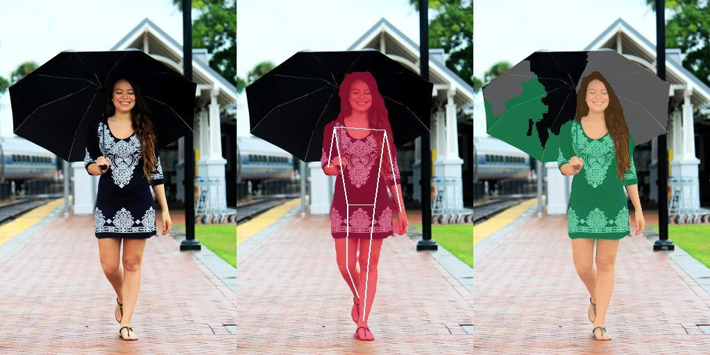
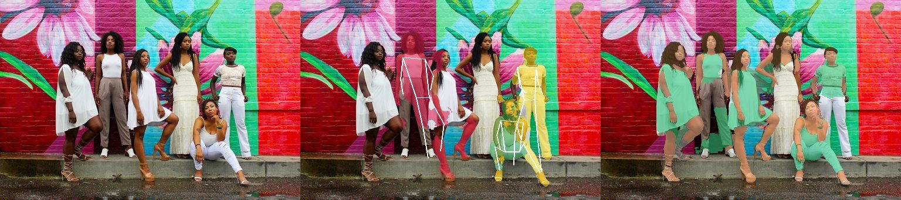
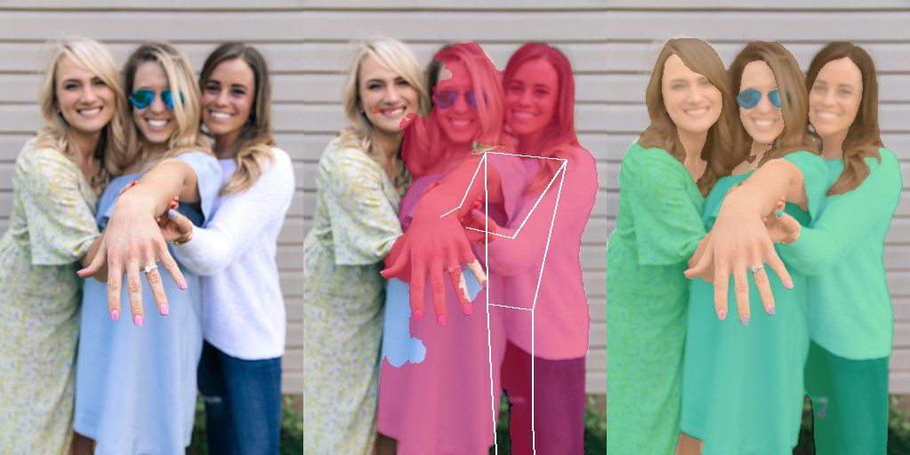

# Segmentación de sujeto y personas en Android (investigación Lane B)

Fecha: 2026-10-28. Alcance: qué necesita Android para producir **las mismas entradas**
que iOS entrega hoy al motor C (`ce.h`), con qué modelos on-device empaquetados en el
APK (sin red, sin descargas de Google Play services), y cuánto se pierde frente a Apple
Vision. Todo lo medido aquí se ejecutó de verdad en este Mac: la referencia iOS se
regeneró con `visionmask` (Vision de macOS, el mismo código de `apple/SubjectKit`) y los
candidatos Android se corrieron en Python (MediaPipe Tasks) con **los mismos ficheros
`.task`/`.tflite` que la app Android empaquetaría**. Scripts y salidas crudas:
`harness/out/android-subject/` (`proto.py`…`proto4.py`, `out/results*.json`, ignorado por
git). Comandos exactos de reproducción en el §8.

## Resumen y recomendación

La respuesta corta: **el motor C no se toca**. SubjectKit ya está diseñado con la frontera
que Android necesita («la plataforma detecta; el motor decide la geometría y la piel»,
ADR-010). Lo que hay que reescribir en Kotlin es solo el detector: producir máscaras de
persona por instancia, poses de 15 puntos, cajas de cara y muestras de piel de cara en
píxeles del raster de ≤1024 px, y volver a implementar en Kotlin la lógica **geométrica
sin color** de SubjectKit (asociación, evidencia corporal, separación de fusionadas,
cadena de regiones/piel con sus constantes). Todo el color sigue en C vía JNI.

Pipeline recomendado, todo MediaPipe Tasks salvo las caras:

| Rol (equivalente Vision) | Modelo recomendado | Bytes | Licencia |
|---|---|---:|---|
| Pose por persona + máscara inicial (`VNDetectHumanBodyPoseRequest` + semilla) | Pose Landmarker **Full** float16, `numPoses=8`, umbrales **0,3**, `outputSegmentationMasks=true` | 9.398.198 | Apache-2.0 |
| Máscara de instancia de persona (`VNGeneratePersonInstanceMaskRequest`) | Interactive Segmenter **MagicTouch** (un punto por persona: centro cuello→raíz) | 6.227.884 | Apache-2.0 |
| Piel/pelo/ropa semántica (apoyo a la muestra de piel) | Image Segmenter **SelfieMulticlass 256** | 16.371.837 | Apache-2.0 |
| Caras a cualquier distancia (`VNDetectFaceLandmarksRequest`, caja) | **YuNet** ONNX (`face_detection_yunet_2023mar.onnx`) vía ONNX Runtime Mobile | 232.589 | MIT (modelo) / Apache-2.0 (zoo) |
| Landmarks de cara para mejillas/frente (opcional, ver §5.4) | Face Landmarker `.task` sobre el recorte YuNet | 3.758.596 | Apache-2.0 |
| Cajas de persona (`VNDetectHumanRectanglesRequest`, evidencia y rescate) | Object Detector EfficientDet-Lite2 float16, clase `person` (opcional v1) | 12.138.859 | Apache-2.0 |

Resultado medido en las 8 fotos CC0 de `harness/people` + la selfie sintética: con pose
Full a umbral 0,3 + máscara interactiva, el IoU por persona contra Vision es **0,82–0,98**
en fotos de 1–2 personas y en 5–6 de las 7 personas del grupo difícil (07); el acuerdo de
etiqueta arriba/abajo de `ce_mask_garment_regions` alimentado con la pose Android es
**≥0,97** donde ambas poses describen a la misma persona; y el camino completo Android
(detección propia → `ce regions|skin|garment-regions|garments`) da **el mismo top-1 de
Wada que iOS en 01, 02, 03 y 04, y el mismo top-3 (permutado) en 06**. Las brechas reales
son tres y están localizadas: grupos muy ocluidos o pegados (06 solo encuentra 1 pose de
5; 05 y la selfie apretada mezclan personas), la elección de «persona más grande» puede
divergir cuando las máscaras difieren, y la piel de piernas/brazos exige portar entera la
cadena de aprendizaje de SubjectKit, no una sola llamada a `ce skin`. BlazeFace (el
detector de caras de MediaPipe) **no sirve**: es de rango corto y encontró 0 caras en 6 de
9 fotos donde Vision y YuNet sí las ven. ML Kit Subject Segmentation queda descartado por
diseño: solo existe como modelo descargado por Play services.

Coste de APK del subconjunto mínimo recomendado (pose Full + MagicTouch + multiclass +
YuNet): **32,2 MB de modelos** + `libmediapipe_tasks_jni.so` **14.367.776 B (arm64-v8a)**
en tasks-core 1.1.1 + el `.so` de ONNX Runtime Mobile si se usa solo para YuNet (ver la
alternativa sin ORT en el §5.4). Sin `INTERNET` en ninguno de los manifiestos de librería
revisados (hay que seguir comprobando el manifiesto fusionado en el lane A).

## 1. El contrato exacto SubjectKit → motor C

Fuentes: `apple/SubjectKit/Sources/SubjectKit/*`, `engine/Sources/ColorEngine/ColorEngine.swift`
(wrapper sobre `engine/Sources/CColorEngine/include/ce/ce.h`), `ios/ColorsApp/Engine/EngineBridge.swift`,
`ios/ColorsApp/Views/Feed/ScanAnalyzer.swift`, `docs/DECISIONS.md` ADR-010/011 (checkout principal).

### 1.1 El raster (entrada común de todo)

Tanto Vision como el motor ven **el mismo buffer** (`ScanAnalyzer.analyze` rasteriza una
sola vez y pasa el mismo puntero a `SubjectExtractor.compute` y a `ColorEngine.analyze*`):

- Imagen **orientada hacia arriba** (EXIF aplicado antes), dibujada en un contexto **sRGB
  de 8 bits, RGBX `noneSkipLast`** (4 B/px, alfa ignorada), fondo blanco, lado mayor
  **≤1024 px** conservando el aspecto y **sin ampliar nunca**; `stride = width*4`.
  Dimensiones: `scale = maxSide/max(W,H)`, cada lado `max(1, round(lado*scale))`
  (`EngineBridge.targetSize`, `SubjectRaster.targetSize`). Interpolación alta solo si hay
  reescalado. La conversión Display P3/ICC → sRGB la hace CoreGraphics al dibujar; el
  equivalente Android es decodificar con `BitmapFactory`/ImageDecoder pidiendo sRGB y
  reescalar una vez (ver el riesgo de paridad de color en el §6: no es bit a bit, y no
  hace falta que lo sea; lo que tiene que coincidir es el pipeline a partir del raster).
- Todas las máscaras: `width*height` bytes **empaquetados sin stride**, fila a fila desde
  arriba-izquierda, valores 0…255. Coordenadas en píxeles del raster, origen
  arriba-izquierda, `y` hacia abajo; el centro del píxel `(i,j)` es `(i+0.5, j+0.5)`.
  «Cobertura» = fracción de píxeles con valor `>=128`.
- El motor reduce después por su cuenta a lado ≤256 (`ce_palette_opts.max_side`, box
  entero); eso no es asunto del detector.

### 1.2 Lo que el detector de plataforma debe producir (`PersonInstance`)

Por cada persona (ordenadas por cobertura descendente, desempate por id; **máximo 8**):

| Campo | Formato exacto | Notas |
|---|---|---|
| `mask` | `[UInt8]` `W*H`, blanda 0…255 | La cadena trabaja siempre con su binarización `>=128 → 255`. En iOS sale de `VNGeneratePersonInstanceMaskRequest.generateScaledMaskForImage` reescalada con CoreGraphics (interpolación alta). Instancias con cobertura `<0,0005` del raster se descartan como fragmentos (`minPersonCoverage`, ≈350 px en 1024×683). |
| `pose` | 15 `Keypoint(x,y,confidence)` en píxeles del raster, orden `ce_joint`: `nose, neck, leftShoulder, rightShoulder, leftElbow, rightElbow, leftWrist, rightWrist, leftHip, rightHip, leftKnee, rightKnee, leftAnkle, rightAnkle, root` | `neck` = punto medio de hombros y `root` = punto medio de caderas (definición de Vision). `confidence<=0` = ausente. «Utilizable» = finito, `confidence>=0,3` (`ce_region_opts.min_confidence`) y `|x|,|y|<=1.048.576`. «left/right» = izquierda **de la persona**. |
| `faceSampleMask` | `[UInt8]` `W*H`, 255 en mejillas y frente, o `nil` | Polígonos afines desde landmarks oculares/labiales (`FaceSample.swift`, §1.6), intersectados con la persona erosionada 2 px. El motor exige `>=50` píxeles `>=128` (`CE_SKIN_MIN_SAMPLES`). |
| `faceBox` | rectángulo en píxeles del raster, o `nil` | Sin pose fija la altura de `cutHead`; también asocia la cara y alimenta las semillas. |
| `splitFrom` | id de la instancia origen si la persona se separó de una fusionada | Solo trazabilidad y pasos; no lo consume el motor. |

Y a nivel de foto: las poses y caras **sin asociar** también se conservan durante la
detección (hacen falta para construir semillas y para la evidencia corporal), más las
cajas de persona de cuerpo entero (`humanRectangles`, confianza ≥0,3) que en iOS se piden
solo si alguna instancia/semilla de cara las necesita.

### 1.3 Las llamadas al motor C (esto es lo que Android reutiliza tal cual vía JNI)

La cadena (`SubjectChain.swift`) no calcula color: elige entradas y llama, por persona y
sobre su máscara **binaria** `B`, a estas funciones de `ce.h` (signaturas abreviadas):

```c
int ce_mask_clothing_regions(const ce_pose*, const ce_region_opts*, uint8_t* inout_mask, int w, int h);
int ce_mask_cut_head(uint8_t* inout_mask, int w, int h, double fraction);            // fraction en [0, 0.5]
int ce_mask_garment_regions(const ce_pose*, const ce_region_opts*, const uint8_t* person_mask,
                            int w, int h, uint8_t* regions_out);                     // 0 fuera, 1 arriba, 2 abajo
int ce_skin_model_fit(const ce_image*, const uint8_t* sample_mask, ce_skin_model* out);
int ce_mask_exclude_skin(const ce_image*, const ce_skin_model*, const ce_skin_opts*, uint8_t* inout_mask);
int ce_mask_split_instance(const uint8_t* mask, int w, int h, const ce_person_seed* seeds,
                           int n_seeds /*1..8*/, uint8_t* labels_out);
int ce_analyze(ce_ctx*, const ce_image*, const ce_palette_opts*, const ce_match_opts*, ce_result*);
int ce_analyze_garments(ce_ctx*, const ce_image*, const uint8_t* region_map, int n_regions /*2*/,
                        const ce_palette_opts*, const ce_garment_opts*, const ce_match_opts*,
                        ce_result*, ce_garment_swatch*, int cap);
```

con `ce_image{ pixels RGBA8/RGBX8, width, height, stride_bytes, fmt, mask }` donde
`mask` (o `NULL` = foto entera) multiplica el peso de cada píxel, y `ce_person_seed{x0,y0,
x1,y1,half_width}` = eje del cuerpo (cuello/base de la cara → caderas/extrapolado) y
semiancho en píxeles. Errores que son **retornos previstos** (no excepciones):
`CE_ERR_POSE` (-8, faltan hombros o caderas ni por simetría: `2·NECK−S` / `2·ROOT−H`),
`CE_ERR_SKIN_SAMPLES` (-9, <50 muestras) y `CE_SKIN_GUARD` (1, la salvaguarda del 35 %
saltó y la máscara queda intacta). Un `ce_ctx` por tarea (`ce_ctx_size`/`ce_ctx_init`,
memoria del llamante alineada a 16, ≤2 MiB).

Valores que usa **la app** hoy (todos `*.default` del motor salvo lo anotado):
`PaletteOptions.default` (k 6, 20 iteraciones, 5 colores, lado 256, σ centro 0,35,
fusión ΔE00<5, descarte <5 %, `skin_rule=0`, `merge_light_de=0`),
`MatchOptions.default` = `EngineBridge.appMatchOptions` (kL=kC=kH=1, λ=1, gap=1,
exposición ±1 EV penalización 2, **iluminante desactivado**, ADR-009),
`GarmentOptions.default` (shade_kL 3, shade_merge_de 6,5, percentiles 0,75/0,95,
segundo color ≥25 %, 2 por región), `regionCount = CE_GARMENT_MAX_REGIONS = 2`, `topK=3`.
SubjectKit usa su propio preajuste de piel: **Mahalanobis 2,75** (el motor trae 2,5) con
salvaguarda 0,35.

### 1.4 La cadena por persona (lógica que hay que portar a Kotlin, con constantes)

Esto es geometría y recuentos; no hay ni una decisión de color fuera del motor. Resumen
fiel de `SubjectChain.swift` + `RegionPlanning.swift` con los valores por defecto de
`SubjectOptions.default` (modo `largestPerson`, región `clothing`, piel adaptativa,
`computeGarmentRegions=true` en la app vía `SubjectSettings.subjectOptions`):

1. **Suelo** `minCoverage=0,0005`: `suelo = max(ceil(0,0005·W·H),1)` px.
2. **Muestra de piel**: la de su cara; si no es utilizable (<50 muestras) y
   `shareSkinModel`, la de la persona de la foto con más muestras. Modelo =
   `ce_skin_model_fit` (gaussiana Lab, covarianza + `1,0·I`).
3. **Pose de región** (`regionPose`): si el motor no puede formar las caderas pero sí los
   hombros, se **estiman**: raíz a `1,2` anchos de hombros (sw) en la normal a la línea de
   hombros (lejos de la nariz; si no, hacia abajo), caderas a `0,75` de la separación de
   hombros, rodillas/tobillos borrados (`hipsEstimated`).
4. **Regiones de ropa** con `ce_region_opts_default` (conf. 0,3; margen torso 0,12 sw;
   ancho de cápsula 0,45 sw; brazos sí, **antebrazos no**, piernas sí enteras; nunca
   cabeza ni manos: cápsula de mano 0,45/0,2 sw):
   - sin modelo de piel: **prueba de mangas** (los brazos se quedan si ≥70 % de sus
     píxeles está a Mahalanobis ≤2 del gaussiano del torso);
   - con modelo: **piel del cuerpo aprendida** (si brazos o piernas tienen ≥25 % de piel
     con el modelo de la cara, hasta 2 pasadas amplían la muestra con píxeles a
     Mahalanobis ≤3 y reajustan; se para si dispararía la salvaguarda) y **prueba de
     brazos desnudos** (≥25 % piel ⇒ brazos fuera);
   - **silueta de la pose**: misma llamada con margen 0,35, cápsulas 1,0 sw, antebrazos y
     piernas enteras. Se usan las regiones si miden ≥15 % (`minRegionFraction`) **de la
     silueta**; si no, la silueta. Si la silueta no llega al suelo o hay `CE_ERR_POSE`:
     `cutHead` con fracción = borde inferior de la cara +0,25·alto de cara sobre el alto de
     la persona, acotada a [0,18; 0,5] (0,18 sin cara). Con pose **nunca** se vuelve a la
     instancia cruda (deja fuera cochecitos, motos, bolsos).
5. **Piel**: `ce_mask_exclude_skin` a 2,75; **crecimiento en sombra** (candidatos a
   Mahalanobis ≤5 conectados por vecindad-8 en ≤12 pasos a la piel quitada; topes: piel+
   crecimiento ≤35 % y crecimiento ≤0,5·piel quitada); **halo** Chebyshev de 2 px.
   Crecimiento y halo son geometría de SubjectKit sin comando `ce` propio: en Android se
   reimplementan en Kotlin igual (BFS por capas en orden de índice) o se proponen al motor
   (la propuesta ya está escrita en ADR-010 y sigue abierta; no es requisito del port).
6. **Respaldo**: si la máscara final no llega al suelo, la silueta (con pose) o la persona
   binaria (`wholePerson`); si tampoco, sin máscara (`none` ⇒ foto entera).
7. **Regiones de prenda** (ADR-011): `ce_mask_garment_regions(pose', opcionesDeSilueta,
   máscaraFinalDeEsaPersona)`; si `hipsEstimated`, todo 2 pasa a 1. Sus píxeles >0 son
   exactamente los de la máscara final. Sin pose (headCut), `wholePerson` o sin máscara:
   mapa `nil` ⇒ camino clásico `ce_analyze`.

Modos: `largestPerson` (defecto), `selectedPerson` (índice en `people`),
`allPeople` (unión por máximo de las cadenas que llegan al suelo; el mapa de prendas va
**por persona** y `SubjectMaskResult.garmentRegions` es `nil`), `off` (sin detección).
Pasos (`MaskFallback`): `none, noPeople, poseRegions, headCut, wholePerson, skinExcluded,
skinGuard, visionUnavailable, rejectedPhantom, garmentRegions, splitByPose, splitByFace`.
En Android `visionUnavailable` se lee «detector no disponible» y debe conservar la misma
semántica: sin máscara y sin crash.

### 1.5 Separación de personas fusionadas y evidencia corporal (también a portar)

- **Semillas** (`PersonSplit.swift`): pose con cuello o dos hombros ⇒ eje cuello/media de
  hombros → raíz/media de caderas (o extrapolado `1,6·sw` hacia abajo), semiancho
  `0,55·sw` (mín. `0,6·` ancho de cara); cara sin pose ⇒ base de la caja → `3,0·` alto,
  semiancho `1,1·` ancho. Cara+pose se fusionan si el centro de la cara está a
  `<0,8·` ancho de cara del cuello o la nariz (emparejamiento voraz por distancia).
- Una semilla **cuenta** para una instancia si su cara cae dentro (`>=128`) o su punto
  superior está en la máscara dilatada `0,25·` ancho de cara **y** ≥ la mitad de las 17
  muestras de su eje está dentro. Con ≥2 semillas se llama a `ce_mask_split_instance`
  (argmín distancia-al-eje/semiancho; cada semilla con cara aporta además un segmento de
  cabeza de semiancho `0,5·` ancho de cara; máx. 8 semillas en el motor). Partes con
  `<0,5 %` del raster (`minSplitCoverage`) se reasignan a la vecina conservada; si quedan
  <2, no se toca la instancia.
- **Semilla de cara sin pose ⇒ evidencia corporal obligatoria**
  (`requireBodyForFaceSeeds`): una caja de persona **suya** (contiene el centro de la
  cara, empieza como mucho 1 alto de cara por encima y 0,5 por debajo de su borde
  superior, y baja ≥1 alto por debajo) o ≥2 puntos utilizables de una pose ajena bajo la
  cara dentro de su eje. Sin esto, un póster/pantalla/cara estampada crea una persona
  fantasma con media ropa de la real (medido en `harness/people/faces`).
- **Anti-fantasmas** (`PersonEvidence.swift`), en orden: (1) pose con ≥2 puntos del torso
  (cuello, hombros, caderas, raíz; conf. ≥0,3) dentro de la máscara (tolerancia Chebyshev
  2 px); (2) cara asociada; (3) caja de persona asociada con ≥50 % de los píxeles de la
  instancia dentro y ≥10 % de relleno de la caja; (4) forma sola **desactivada** (una
  prenda colgada cumple la forma de persona). Lo demás se descarta
  (`rejectedPhantoms`); si no queda nadie, foto entera.
- **Asociación** pose↔instancia: 8 muestras por segmento del esqueleto entre puntos
  utilizables, torso cuenta doble, hace falta ≥1 muestra de torso dentro; cara↔instancia:
  muestras del centro de la caja. Una pose/cara por persona (desempates documentados en
  `VisionDetector.associatePoses/associateFaces`).

### 1.6 La muestra de piel de la cara (`FaceSample.swift`)

Marco afín `P(s,t)=M+s·h+t·w` con `M`=media de centros de ojos, `h`=(ojoB−ojoA)/2,
`w`=centro de boca −M. Mejilla σ=±1: `(0,62σ;0,28),(1,38σ;0,28),(1,32σ;0,72),(0,68σ;0,72)`,
recortada por la envolvente convexa del contorno facial. Frente: `s∈[−0,8;0,8]`,
`t∈[c−0,32;c−0,08]` con `c` = `t` mínimo de las cejas (−0,32 sin cejas), recortada por la
caja de cara ampliada 5 % hacia arriba. Todo ∩ persona erosionada 2 px. **Entradas
mínimas**: centroides de ojo izquierdo/derecho y de labios exteriores (sin ellos no hay
polígonos); cejas y contorno son opcionales pero mejoran el recorte. Esto decide qué
detector de landmarks vale en Android (§2, §5.4): hacen falta ojos/labios (y a ser posible
cejas/contorno), no solo la caja.

### 1.7 Lo que sale hacia la app (para que el inspector de capas sea el mismo)

`SubjectMaskResult{ people, chosenIndex, mask: [UInt8]? (0/255; nil=foto entera),
garmentRegions: [UInt8]? (0/1/2), steps, timings, maskCoverage, layers, rejectedPhantoms }`.
El inspector iOS pinta 12 capas (`LayerStack.LayerId`: foto, raster, reducida, personas,
pose, piel, máscara final, **prendas**, pesos, etiquetas, paleta, explicación); las de
sujeto salen de `PersonLayers` (persona binaria, pose dibujada, silueta, brazos probados,
región, muestra de piel, muestras aprendidas, piel quitada/crecida, máscara final por
persona, decisión de región con recuentos, mapa de prendas) + `allPeopleOverlay` (id de
persona por píxel). Android debe producir los mismos bitmaps si quiere «cada etapa visible
como capa»: es el mismo struct, rellenado por la cadena Kotlin y por las capas de
depuración del motor (`ce_palette_debug_info`, `ce_debug_*`, `ce_debug_garment_map`,
`ce_debug_region_map`, `ce_match_explain_combo`), que ya son C compartido.

**En una frase**: Android tiene que entregar, por foto y en el raster ≤1024: hasta 8
× {máscara `W*H`, pose 15×(x,y,conf), caja de cara?, muestra de piel `W*H`?} + cajas de
persona para evidencia. Todo lo demás ya existe.

## 2. Opciones en Android (todas on-device; licencia y empaquetado verificados)

Criterios de descarte, en este orden: (a) exige red o descarga del modelo en tiempo de
ejecución; (b) licencia incompatible con una app **de pago** en Play; (c) no produce lo
que el contrato pide (instancias, pose 15, cara con landmarks, clases de piel). Tamaños =
bytes exactos del fichero medidos aquí (`stat` + `Content-Length` del origen; coinciden,
ver §8.3). Latencias de teléfono = tablas oficiales de Google (Pixel 6 salvo nota); las de
este Mac están en el §3 y **no** extrapolan a un gama media.

### 2.1 MediaPipe Tasks Vision (la vía principal)

SDK: `com.google.mediapipe:tasks-vision` (Google Maven; última **1.1.1**, 2026-10-14, con
el nativo en `tasks-core`: `libmediapipe_tasks_jni.so` **14.367.776 B arm64-v8a**,
10.099.244 armeabi-v7a; AAR de visión 610.482 B sin `.so`). La serie 0.10.x trae el nativo
en el propio AAR (`libmediapipe_tasks_vision_jni.so` 10.422.848 B arm64 en 0.10.29, medido).
`minSdk 24` en ambos manifiestos de librería; **ninguno declara `INTERNET`** (revisado con
`strings` sobre el `AndroidManifest.xml` de cada AAR; la comprobación que manda es la del
manifiesto fusionado del APK final). Licencia del SDK y de los modelos: **Apache-2.0**
(model cards de BlazePose GHUM y Multiclass enlazan la licencia; MagicTouch también).
Los modelos se cargan desde `assets/` o fichero: **empaquetados, sin descarga**. Se
recomienda fijar una versión (1.1.1 u 0.10.35) y no seguir «latest»: la API Python 1.2.0
usada aquí ya renombra el segmentador interactivo (`InteractiveSegmenterLegacy` en Python;
en el AAR Android 1.1.1 la clase sigue siendo `InteractiveSegmenter` con
`RegionOfInterest`, verificado en `classes.jar`). Delegate CPU (XNNPACK) o GPU; para una
foto suelta el CPU evita la variabilidad de drivers GPU y basta (ver latencias).

- **Pose Landmarker** (`pose_landmarker_{lite,full,heavy}.task`, float16: 5.777.746 /
  **9.398.198** / 30.664.242 B). Salida por pose: 33 landmarks BlazePose normalizados
  (x, y, z, visibility, presence) + landmarks en mundo + **máscara de segmentación
  opcional por pose** (float, a resolución de entrada). `numPoses` (defecto 1) es el
  máximo de poses; hay que ponerlo a 8 y bajar `min_pose_detection_confidence`,
  `min_pose_presence_confidence` y `min_tracking_confidence` de 0,5 a **0,3** (medido:
  sin bajarlos se pierden personas enteras, §3). Es un detector *top-down* (detecta
  personas y luego ajusta landmarks por recorte): sus máscaras ya vienen **por persona**,
  lo que cambia el problema respecto a Vision (ver §5.2). Mapeo a `ce_pose` en el §5.1.
  Google no publica latencia Android de esta tarea en la página consultada; en este Mac
  (CPU, XNNPACK): Full ≈13–38 ms/foto según nº de poses, Lite ≈12–32 ms, Heavy ≈20–81 ms.
- **Interactive Segmenter / MagicTouch**. Dos generaciones: el modelo *legacy* float32
  `magic_touch.tflite` (**6.227.884 B**, el medido aquí, API de un solo paso
  imagen+punto) y el v2 int8 `interactive_segmentation.task` (**30.525.312 B**, entrada
  768×768, API con estado; Pixel 10: 208,2 ms CPU / 580,6 ms GPU según Google). El v2 no
  se midió: cuesta 5× el tamaño. La salida legacy es una `category_mask` donde
  **0 = objeto señalado y 255 = fondo** (polaridad verificada experimentalmente; con la
  polaridad al revés el IoU cae a ~0,00 y con la correcta sube a 0,89–0,98). Un punto por
  persona basta para una máscara de instancia mejor que la de la pose (§3). Primer chequeo
  del wave-2: confirmar qué fichero acepta el `InteractiveSegmenter` del AAR fijado.
- **Image Segmenter SelfieMulticlass 256×256** (`selfie_multiclass_256x256.tflite` float32,
  **16.371.837 B**). Clases: `0` fondo, `1` pelo, `2` piel del cuerpo, `3` piel de la cara,
  `4` ropa, `5` otros. Pixel 6: **217,76 ms CPU / 71,24 ms GPU** (Google). Es **semántico,
  no por instancia**, y su resolución interna 256 lo hace grueso en bordes (ver la
  Figura 1: tiñe el paraguas). Su papel en el pipeline no es sustituir a la máscara de persona
  sino (i) dar una **muestra de piel** cuando no hay landmarks de cara (clase 3 ∩ persona,
  erosionada) y (ii) servir de red de seguridad/medida. En este Mac: ≈16–27 ms.
  Alternativas del mismo API, descartadas como fuente principal: `selfie_segmenter.tflite`
  float16 (249.537 B; persona/fondo sin instancias ni clases; Pixel 6 ≈33–35 ms) y
  **DeepLabV3** (`deeplab_v3.tflite`, 2.780.176 B, Pascal VOC 21 clases, `person=15`;
  Pixel 6 123,93/103,30 ms): semántico y con IoU persona 0,28–0,87 medido — peor y sin
  separar personas.
- **Face Detector** (BlazeFace *short-range*, 229.746 B). Pensado para caras cercanas
  (<2 m, selfie). Medido: **0 caras en 01, 02, 06 y 07** donde Vision encuentra 1/1/1/6.
  Descartado como detector de caras del pipeline (solo valdría para el visor en directo).
- **Face Landmarker** (`face_landmarker.task`, 3.758.596 B; 478 landmarks + blendshapes
  opcionales, `numFaces` configurable). Su detector interno es el mismo BlazeFace de
  rango corto: en foto entera encontró 0 caras en las mismas fotos (2 en 05 y 1 en la
  selfie, que son primer plano). Sí sirve **sobre un recorte** alrededor de una caja
  detectada por YuNet (§5.4), donde la cara ya es grande.
- **Object Detector EfficientDet-Lite0/Lite2** (float16: 7.254.339 / 12.138.859 B; int8:
  4.602.795 / 7.515.971 B). Clase COCO `person` con caja y score. Medido (Lite2, umbral
  0,3): cajas casi idénticas a las anotadas a mano en `expected.json` (p. ej. 01:
  [406,264,644,671] frente a la pista [395,262,645,680]) y 6 cajas en 06 donde la pose
  solo ve 1 persona. Es el equivalente directo de `VNDetectHumanRectanglesRequest` para
  la evidencia corporal y un posible rescate de personas sin pose (§5.2). ≈26–28 ms/foto
  en este Mac, independientemente del tamaño (entrada fija del modelo).

### 2.2 YuNet vía ONNX Runtime Mobile (las caras)

`face_detection_yunet_2023mar.onnx` (**232.589 B**, OpenCV Zoo; caras de ~10×10 a 300×300
px, 5 puntos: dos ojos, nariz, dos comisuras). Licencias: repositorio Apache-2.0, modelo
con `LICENSE` **MIT** (Shiqi Yu) — ambas permiten uso comercial. Medido con
`cv2.FaceDetectorYN` (score ≥0,6): **14/14 caras de Vision localizadas** en las 8 fotos
(incluidas las 6 de 07 y las pequeñas de 01/02), más 2 caras extra en 06 (Vision solo
asocia 1) y la cara con mascarilla de 08 que Vision no da (≈2–13 ms/foto en este Mac).
En Android la vía limpia es ONNX Runtime Mobile (`com.microsoft.onnxruntime:
onnxruntime-android`, release 1.31.1 en Maven Central; AAR de 55.138.794 B con 4 ABIs —
imprescindible publicar con splits por ABI o AAB para pagar solo un `.so`). ONNX Runtime
es MIT. Si se quiere evitar un segundo runtime solo por 233 KB de modelo, las alternativas
son convertir YuNet a `.tflite`/LiteRT y correrlo con el intérprete que ya trae MediaPipe
**no** (Tasks no expone un intérprete genérico), o usar ML Kit Face Detection *bundled*
(§2.3). Los 5 puntos de YuNet (ojos y comisuras) bastan para el marco afín de
`FaceSample` (ojos + boca = media de comisuras), sin cejas ni contorno: la frente usa el
defecto `c=-0,32` y la mejilla no se recorta por contorno (válido; ver §5.4).

Otras familias ONNX evaluadas sobre el papel y **descartadas sin medir**: YOLOv8/YOLO11-seg
de Ultralytics (instancias de persona muy buenas, pero pesos y código bajo **AGPL-3.0**:
incompatible con distribuir una app cerrada de pago sin licencia empresarial), y los
*parsers* de ropa tipo SCHP (código MIT pero entrenados con LIP/ATR: LIP es **no comercial**;
además dan partes semánticas, no el contrato de 15 puntos + instancias). Un modelo de
segmentación de instancias tipo Mask R-CNN/YOLACT de los zoos de LiteRT/ONNX podría
revisarse en wave-2 si el tándem pose+MagicTouch no llega en grupos; hoy no hace falta
para decidir.

### 2.3 ML Kit (qué es realmente *bundled* y qué no)

Verificado en la tabla oficial de rutas de instalación y en los AAR descargados:

| API ML Kit | Artefacto | ¿Bundled? | Veredicto |
|---|---|---|---|
| Subject Segmentation | `play-services-mlkit-subject-segmentation:16.0.0-beta1` | **No**: «the model is dynamically downloaded using Google Play services» | **Descartada** (red en runtime + depende de Play services; beta sin actualizar desde 2023-11). |
| Selfie Segmentation | `com.google.mlkit:segmentation-selfie:16.0.0-beta6` | Sí: el AAR (739 KB) trae `selfiesegmentation_mlkit-256x256-…f16.tflite` (249.024 B) | Válida pero inútil aquí: persona/fondo sin instancias ni clases (≈ el `selfie_segmenter` de MediaPipe). |
| Pose Detection | `com.google.mlkit:pose-detection:18.0.0-beta5` (+ `-accurate`) | Sí: AAR con `pose_person_detector_f16.tflite` (2.962.288 B) + `pose_landmark_detector_lite_f16_inf.tflite` (2.813.968 B) | Válida y pequeña, pero es el mismo BlazePose *lite* orientado a **una** persona en primer plano, sin máscara por pose; MediaPipe Full con `numPoses=8` cubre más. No medida aquí. |
| Face Detection | `com.google.mlkit:face-detection:16.1.7` | Sí (*bundled*: `libface_detector_v2_jni.so` 8.520.960 B arm64 dentro del AAR de ~17 MB) | Detecta caras a distancia con landmarks básicos (ojos, nariz, boca, contorno opcional). Es la alternativa sin ONNX Runtime a YuNet; cuesta ~8,5 MB/ABI frente a 0,23 MB de modelo YuNet + el `.so` de ORT. No medida aquí (no hay binding de escritorio). |

Todos los AAR de ML Kit revisados declaran `minSdk 21` y ningún permiso de red en su
manifiesto; las variantes *bundled* no descargan nada (las *unbundled* `play-services-mlkit-*`
sí, vía `ModuleInstallClient`). Ojo: ML Kit se distribuye bajo los términos de Google
(no Apache): es gratuito también en apps de pago, pero es un SDK cerrado con telemetría de
uso de la API según su documentación — si el lane de Play (`docs/play/`) prefiere cero
SDKs de Google con recogida de datos, YuNet+ORT deja la ficha de seguridad de datos más
limpia. Esta es una decisión a anotar, no un bloqueo técnico.

### 2.4 LiteRT (ex-TFLite) a pelo

Correr los `.tflite` sueltos con el intérprete LiteRT sin MediaPipe Tasks es posible
(los modelos anteriores son TFLite estándar), pero obliga a reescribir pre/post-proceso de
cada tarea (detección→recorte→landmarks de BlazePose, decodificación de EfficientDet,
etc.) que Tasks ya trae probado. Solo compensa si el tamaño del `.so` de Tasks (14,4 MB
arm64) resultara inaceptable. No se midió: no cambia ningún resultado de calidad, solo el
empaquetado.

## 3. Medición del prototipo contra la referencia iOS

### 3.1 Método (y qué no es)

- **Fotos**: las 8 CC0 de `harness/people` (lado mayor 1024, `expected.json` con personas
  y prendas anotadas a mano) + `synthetic_tight_selfie.png` (213×320, derivada de 05 que
  fuerza la fusión de Vision).
- **Referencia iOS**: `visionmask` recién compilado en este Mac (macOS 27) sobre cada
  foto (`--layers`, y la variante `largest-clothing-skin-garments`): instancias de Vision,
  personas tras separar (`*.instances_split.pgm`, etiquetas por persona), poses
  (`*.json: all_poses`), capas y mapas de prenda (`*.garments.pgm`). Vision dio
  1/1/2/2/3/4/4/1 instancias → **1/1/2/2/3/4/7/1 personas** tras la separación (y 2→3 en
  la selfie), idéntico a lo publicado en ADR-010. Ojo: es la salida de Vision en macOS;
  en un iPhone puede variar ligeramente por revisión de modelos. Es la mejor referencia
  reproducible que deja el repo (no hay máscaras iOS versionadas para estas fotos: solo
  `faces/person01_mask.png` y los conteos de ADR-010).
- **Candidatos**: MediaPipe Tasks en Python (`mediapipe 1.2.0`, venv uv con CPython
  3.12.14, CPU/XNNPACK, arm64) con los ficheros de la tabla del §2, sobre el PNG tal cual
  (ya ≤1024 y sRGB; para el extremo a extremo de color se usó el `*.ppm` que escribe
  visionmask, es decir, **el raster exacto de la app iOS**). YuNet con OpenCV headless.
  El extremo a extremo llama al binario real `ce` (CMake) — el mismo C que irá por JNI.
- **Métricas**: IoU de máscaras binarias (pose ≥0,5; iOS ≥128) contra la etiqueta de cada
  persona iOS (la mejor máscara candidata para cada una), error de pose por articulación
  emparejando por cuello contra `all_poses` (px y px/ancho-de-hombros), acuerdo de
  etiquetas arriba/abajo de `ce garment-regions` con pose Android vs pose iOS sobre la
  intersección de ambos mapas, fracciones de piel/ropa del multiclass dentro de la
  máscara final iOS, y en el extremo a extremo: hex/peso/región de cada prenda y top-3.
  Tiempos: pared por llamada en este Mac (orientativos; incluyen solo inferencia).

### 3.2 Personas, máscaras e IoU

«Esp.» = personas anotadas en `expected.json`. IoU por persona = la mejor máscara de pose
(Full @0,3) contra cada etiqueta iOS, en el orden de `instances_split`. «Interactivo» = un
punto (centro cuello→raíz de cada pose Full @0,3) por persona en MagicTouch legacy.

| Foto | Esp. | iOS personas (inst. Vision) | Poses MP Full @0,5 → @0,3 | IoU máscara pose @0,3 por persona iOS | IoU interactivo por prompt | IoU DeepLab `person` vs iOS `allPeople` |
|---|---:|---:|---:|---|---:|---:|
| 01 negro | 1 | 1 (1) | 1 → 1 | [0,938] | [0,968] | 0,633 |
| 02 vestido+paraguas | 1 | 1 (1) | 1 → 1 | [0,504] | [0,893] | 0,424 |
| 03 pareja denim | 2 | 2 (2) | 1 → 2 | [0,923; 0,917] | [0,902; 0,976] | 0,809 |
| 04 contraluz | 2 | 2 (2) | 2 → 2 | [0,961; 0,825] | [0,951; 0,822] | 0,279 |
| 05 tres amigas | 3 | 3 (3) | 1 → 2 | [0,167; 0,436; 0,499] | [0,659; 0,290] | 0,872 |
| 06 grupo mensajero | 5 | 4 (4) | 1 → 1 | [0,000; 0,000; 0,936; 0,002] | [0,956] | 0,766 |
| 07 grupo mural | 6 | 7 (4) | 3 → 6 | [0,621; 0,553; 0,502; 0,669; 0,041; 0,227; 0,827] | [0,822; 0,633; 0,841; 0,672; 0,608; 0,494] | 0,539 |
| 08 artista mural | 1 | 1 (1) | 1 → 1 | [0,918] | [0,958] | 0,851 |
| selfie sintética | 3* | 3 (2) | 0 → 2 | [0,316; 0,191; 0,387] | [0,124; 0,127] | 0,859 |

Lectura:

- **El umbral 0,5 por defecto es inutilizable para grupos.** Bajar las tres confianzas a
  0,3 pasa 03 de 1→2 poses (IoU 0,92/0,92), 07 de 3→6 (5 de 7 personas con IoU ≥0,5) y la
  selfie de 0→2. Heavy @0,3 mejora algo 07 (media 0,56 frente a 0,49 de Full) a costa de
  30,7 MB y 2–3× el tiempo; Lite @0,3 es casi tan bueno como Full en 03/04/08 pero peor en
  07 (3 de 7 ≥0,5). **Full @0,3 es el equilibrio**; la evidencia corporal de §1.5 filtra
  las poses espurias que el umbral bajo pueda añadir.
- **MagicTouch con un punto por pose supera a la máscara de la pose** casi siempre: es la
  fuente de máscara de instancia recomendada (0,89–0,98 en 1–2 personas; 0,49–0,84 en el
  grupo de 07). En 02 sube de 0,50 a 0,89 porque la máscara de pose excluye el paraguas y
  la instancia de Vision (la referencia) lo incluye — es decir, el «fallo» de la pose en
  02 es en realidad el comportamiento deseado, y de hecho la región de ropa del motor lo
  elimina después en ambos caminos. En 05/selfie (planos medios muy pegados) el punto
  cae a veces sobre la vecina y la máscara se mezcla: ahí manda la separación por
  semillas del motor (§5.2), no un segmentador mejor.
- **Detección, no segmentación, es el cuello de botella en 06**: una sola pose (la persona
  grande en primer plano, IoU 0,94) con cualquier variante/umbral; el resto está ocluido,
  cortado o sentado en la moto. EfficientDet-Lite2 sí ve 6 cajas de persona en 06 y 5 en
  07 (§3.4): es el rescate para contar y, si se quiere, sembrar.
- DeepLabV3 (semántico) nunca es la mejor opción por instancia; su IoU de unión engaña en
  primeros planos (05: 0,87 uniendo a las tres en un solo blob).


*Figura 1 (02): centro — la máscara de pose deja fuera paraguas y fondo; derecha — el
multiclass a 256 px tiñe parte del paraguas como ropa/otros. Por eso el multiclass solo
se usa intersectado con la instancia.*


*Figura 2 (07) con el umbral por defecto 0,5: solo 3 poses y esqueletos cruzados. A 0,3
salen 6 poses (tabla). El multiclass (derecha) marca ropa en las 6, pero sin separarlas.*


*Figura 3 (05), el caso más duro para Android y también para iOS (Vision no da pose a la
central y la cadena cae a `headCut`): personas cortadas, mano en primer plano, tamaños
empatados. Aquí la semilla útil es la cara (§5.2).*

### 3.3 Pose y regiones de prenda

Error de pose (Full @0,3, emparejado por cuello; media sobre articulaciones con confianza
≥0,3 en ambos lados): 01: 8,3 px (0,17 sw, 15 pts) · 02: 8,8 px (0,06 sw) · 03: 11,6 y
22,9 px (0,09/0,20 sw) · 06: 15,6 px (0,11 sw, la única pose) · 08: 33,9 px (0,25 sw, solo
6 pts: busto de perfil) · 07: de 9,6 px (0,14 sw) en las personas bien vistas a 81,5 px
en las dudosas. En 04 la segunda persona da 29,2 px = 1,69 sw porque su ancho de hombros
en la foto es diminuto (brazo levantado, medio perfil): el cociente exagera; el error
absoluto es el de un brazo. Traducción práctica: donde la pose acierta a la persona, las
cápsulas del motor (0,45–1,0 sw de ancho) absorben errores de 0,1–0,2 sw sin cambiar la
región — lo confirma el acuerdo arriba/abajo de `ce garment-regions` con la pose Android
contra la iOS: **0,981 (01), 0,992 (02), 0,966 (04), 0,984 (06), 1,000 (08)** sobre la
intersección de mapas. (En 03/07 la primera pasada emparejó mal a la «más grande» y el
acuerdo no es calculable persona a persona; el extremo a extremo del §3.6 usa la persona
grande por área propia de cada plataforma, que es lo que hará la app.)

### 3.4 Caras y cajas de persona

| Foto | Caras Vision | BlazeFace / FaceLandmarker (foto entera) | YuNet (aciertos sobre Vision) | Cajas `person` EfficientDet-Lite2 @0,3 |
|---|---:|---:|---:|---:|
| 01 | 1 | 0 / 0 | 1 (1) | 1 |
| 02 | 1 | 0 / 0 | 1 (1) | 1 |
| 03 (de espaldas) | 0 | 0 / 0 | 0 (—) | 3 (2 + 1 parcial) |
| 04 (perfil) | 0 | 0 / 0 | 0 (—) | 2 |
| 05 | 3 | 2 / 2 | 3 (3) | 2 |
| 06 | 1 | 0 / 0 | 3 (1) | 6 |
| 07 | 6 | 0 / 0 | 6 (6) | 5 |
| 08 (mascarilla) | 0 | 1 / 0 | 1 (—) | 1 |
| selfie | 2 | 2 / 1 | 3 (2) | 1 |

YuNet es la única opción que reproduce el alcance de `VNDetectFaceLandmarksRequest` en
fotos de cuerpo entero y grupo (donde viven las semillas de cara y la muestra de piel).
Sus extras (06, 08, selfie) no crean personas por sí solos: pasan por la evidencia
corporal de §1.5 igual que en iOS. EfficientDet reproduce el papel de los rectángulos de
persona de Vision y además cuenta personas sin pose (06).

### 3.5 Piel y ropa (multiclass como apoyo, no como verdad)

Dentro de la **máscara final iOS** (`largest-clothing-skin`, ya sin piel), la fracción que
el multiclass etiqueta como piel (clases 2+3) es 0,000–0,006 en 01, 02, 03, 04, 06 y 08;
0,048 en 05; y **0,224 en 07** (la persona elegida por iOS tras separar conserva piel de
piernas en sombra incluso en iOS — límite conocido de ADR-010: piel en la máscara 24,2 %
en esa persona). La fracción «ropa» (clase 4) en esa misma máscara: 0,86–1,00. Es decir,
las clases del multiclass son coherentes con la cadena iOS a nivel de «esto es piel /
esto es ropa», pero a 256 px y sin instancias: valen para **sembrar la muestra** del
modelo gaussiano del motor, nunca para sustituir su exclusión por persona (el modelo
adaptativo por cara es lo que evita borrar un beige/camel de Wada; una clase fija haría
exactamente el daño que ADR-010 midió con la regla YCbCr).

Muestra de piel obtenible sin landmarks (clase 3 ∩ persona, la usada en el §3.6): 862 px
(01), 4.908 (02), 0 (03, de espaldas; 04, perfil — en iOS tampoco hay muestra y manda
`shareSkinModel`/prueba de mangas), 16.413 (05, ¡mezcla las tres caras!: hay que
intersectar con la caja de cara **de esa persona**), 1.157 (06), 1.142 (07), 4.900 (08,
con mascarilla la clase marca frente/mejillas parciales). Con YuNet dando la caja y los
5 puntos por persona, la muestra correcta es la de `FaceSample` (§5.4); la clase 3 queda
como respaldo cuando el landmarker de recorte no se use.

### 3.6 Extremo a extremo de color (detección Android → motor C real)

Camino Android mínimo ejecutado en `proto4.py` (deliberadamente **sin** portar aún la
cadena completa: sin prueba de brazos/mangas, sin aprendizaje de piel, sin crecimiento ni
halo, sin elección regiones-vs-silueta): pose Full @0,3 → persona de mayor área → máscara
MagicTouch (1 punto) → `ce regions` (opciones de la app) → `ce skin` 2,75 con muestra =
clase 3 ∩ persona → `ce garment-regions` (opciones de silueta) → `ce garments --match`
sobre **el mismo PPM** que el camino iOS. Comparación con el camino iOS
(`largest-clothing-skin-garments` + su mapa):

| Foto | Top-3 iOS | Top-3 Android | Prendas iOS → Android (hex, región) |
|---|---|---|---|
| 01 | 117, 69, 337 | **117, 69, 337** | `#0c0e12` entera → `#0b0d12` entera |
| 02 | 69, 139, 119 | **69, 139**, 207 | `#0e0f1b`+`#b7cad4` entera → `#100f18`+`#b5cad4` arriba, **fuga de piel** `#e8b48b` abajo |
| 03 | 218, 324, 49 | **218, 324, 49** | `#c6cedc`/`#5a799a` → `#c5cddb`/`#5d7c9c` (+3er tono tierra en ambos) |
| 04 | 117, 318, 69 | **117, 318, 69** | `#1a1b13` entera → `#181a13` entera |
| 05 | — (iOS: clásico, sin mapa) | 139, 119, 218 | Android da prendas de **otra persona** (jersey blanco `#dfe4fd`, no el vestido azul de la central) |
| 06 | 143, 324, 49 | 324, 49, 143 (mismo conjunto) | `#dde4ed`/`#739dc9` → `#d2dbe8`/`#709bc8` |
| 07 | 139, 69, 221 | 55, 273, 223 | blanco `#e4e9ed` → blanco `#eaecf4` **+ piel** `#a18e84`/`#77655e` (otra mezcla/persona) |
| 08 | 49, 54, 72 | 44, 49, 67 | `#c6ebfe`+`#50a2f5` → `#c5eafe`+`#7eb6fc` (+`#79b8fd` abajo: caderas reales) |

Qué demuestra y qué no:

- Con la **misma persona elegida** y pose correcta (01, 03, 04 y en gran parte 06), el
  resultado de color es prácticamente el de iOS: los hex difieren en 1–3 niveles por
  canal (máscaras ligeramente distintas) y el match no se mueve. El motor no sabe qué
  plataforma detectó: el contrato funciona.
- 02 y 07 muestran exactamente por qué hace falta portar la **cadena entera**: con una
  sola pasada de piel desde la cara, las piernas desnudas con otra luz se quedan y forman
  un swatch de prenda (`#e8b48b` en 02; tonos piel en 07, donde incluso iOS conserva piel
  en esa persona, §3.5). No es un fallo de MediaPipe: es la diferencia entre `ce skin` a
  secas y `SubjectChain` (aprendizaje + crecimiento + halo).
- 05 es divergencia de **selección**, no de color: iOS `largest` = la central (y sin pose
  va al camino clásico); Android elige por área de máscara de pose a otra de las tres. Con
  tamaños empatados el desempate importa tanto como segmentar bien (§5.2).
- 08: Android ve caderas (pose completa hasta rodillas fuera de cuadro) donde iOS las
  estima; por eso aparece un tercer swatch «abajo» del 3 % y el top-1 pasa de 49 a 44 con
  49 segundo. Mismo mecanismo, distinta entrada: aceptable y explicable en la capa de pose.

### 3.7 Tiempos en este Mac (no son tiempos de teléfono)

Medias por foto (CPU, una sola pasada, sin calentar caché entre fotos; `proto*.py`):
Pose Full @0,5 17,0 ms (mediana 15,4), Lite 15,2 ms, multiclass 24,5 ms (mediana 26,3),
DeepLabV3 22,6 ms, interactivo ≈18–24 ms **por punto**, BlazeFace 1,1 ms (inútil pero
rápido), FaceLandmarker 2,6 ms de media (falla rápido sin cara; 7,5 ms cuando la hay),
YuNet ≈2–13 ms, EfficientDet-Lite2 ≈26–28 ms. La cadena Android completa propuesta
(pose + 1 interactivo/persona + multiclass + YuNet) suma del orden de **80–120 ms/foto**
aquí. Para el teléfono, las únicas cifras publicadas por Google son Pixel 6: multiclass
217,76 ms CPU / 71,24 GPU, DeepLabV3 123,93/103,30, y Pixel 10 para MagicTouch v2:
208,2 CPU. Traducción prudente a un gama media actual (p. ej. Pixel 8a / Galaxy A55):
la detección completa debería quedar **muy por debajo del coste iOS medido de Vision
(0,47–0,74 s/foto en Mac, ADR-010)**, en el entorno de 0,3–0,8 s/foto en CPU con varias
personas (el interactivo se paga por persona). Hay que medirlo en dispositivo antes de
prometer nada para el escaneo del carrete (§7).

## 4. Pipeline Android recomendado

Mismo orden lógico que iOS — detectar barato, separar, filtrar fantasmas, cadena — para
que los pasos y las capas signifiquen lo mismo. Todo en modo `IMAGE`, delegate CPU por
defecto, modelos desde `assets/`, un `ce_ctx` por análisis.

1. **Raster**: decodificar la foto orientada, convertir a sRGB 8 bits, reducir a lado
   ≤1024 sin ampliar (`targetSize` de §1.1) en un buffer RGBA propio que se comparte, sin
   copias intermedias, entre MediaPipe (`MPImage` sobre el mismo `Bitmap` o buffer) y JNI
   (`ce_image.pixels`). **No** usar para el motor ningún `Bitmap` reescalado por un loader
   con otro criterio: un solo raster manda.
2. **Pose Landmarker Full** (`numPoses=8`, tres umbrales 0,3, `outputSegmentationMasks`):
   produce las poses (→ `ce_pose`, §5.1) y una máscara blanda por pose (candidata de
   instancia y semilla de selección).
3. **YuNet** sobre el raster: cajas de cara + 5 puntos por cara.
4. **EfficientDet-Lite2 `person`** (recomendado ya en v1: 12,1 MB): cajas de persona.
   Se puede ejecutar siempre (cuesta como el multiclass) en vez de «solo si hace falta»
   como los rectángulos de Vision; simplifica la evidencia y el conteo.
5. **Máscaras de instancia**: por cada pose, un punto MagicTouch en el centro del eje
   cuello→raíz ⇒ máscara 0/255 (0=foreground en el modelo legacy: invertir). Si el
   interactivo falla o devuelve una máscara absurda (cobertura <0,0005 o IoU <0,3 con la
   máscara de la pose), se usa la máscara de la pose binarizada a 0,5. Descartar
   fragmentos <0,0005. Solapes entre instancias: no se resuelven aquí (la cadena
   binariza por persona, igual que con los halos de Vision).
6. **Semillas y separación**: construir semillas de pose y de cara con las reglas de §1.5
   y aplicar la evidencia corporal **tanto** a las semillas de cara sin pose como a las
   personas resultantes. A diferencia de Vision, las instancias ya vienen por pose, así
   que `ce_mask_split_instance` solo actúa cuando una misma máscara (interactiva o de
   pose) contiene ≥2 semillas — pasa en 05/selfie porque MagicTouch devuelve a la vecina
   o la pose funde dos cuerpos (§5.2). Caras YuNet sin pose asociada pero con caja de
   persona suya crean persona por semilla de cara (su máscara inicial = interactivo con
   punto bajo la cara, o la porción separada con el motor).
7. **Multiclass** una vez por foto: guardar el mapa de categorías `W*H` para la muestra
   de piel de respaldo y para la capa de inspección; nada más depende de él.
8. **Muestra de piel por persona**: `FaceSample` con los puntos YuNet de su cara (y, si
   se incluye el landmarker, con landmarks del recorte: §5.4); respaldo = clase 3 del
   multiclass ∩ (caja de cara dilatada) ∩ persona erosionada.
9. **Cadena Kotlin** = port literal de `SubjectChain` + `RegionPlanning` + `MaskOps`
   (binarizar, stats, erosión/dilatación Chebyshev, crecimiento conectado, halo) llamando
   por JNI a `ce_mask_clothing_regions`, `ce_mask_cut_head`, `ce_skin_model_fit`,
   `ce_mask_exclude_skin`, `ce_mask_garment_regions`. Mismas constantes (§1.4).
10. **Análisis**: con mapa de prendas ⇒ `ce_analyze_garments`; sin mapa ⇒ `ce_analyze`;
    capas con `ce_palette_debug_info`/`ce_debug_*` en el mismo contexto. Fallos del
    detector (excepción de MediaPipe, modelo corrupto) ⇒ pasos `[visionUnavailable]` y
    foto entera, nunca un crash.

Qué **no** llevar: BlazeFace/FaceDetector de Tasks, DeepLabV3, `selfie_segmenter`,
Pose Heavy (30,7 MB por +0,07 de IoU medio en 07) y MagicTouch v2 (30,5 MB sin medir).
Qué dejar preparado: un hueco para sustituir la fuente de instancias por un segmentador
de instancias Apache/MIT futuro sin tocar la cadena (la frontera es `PersonInstance`).

## 5. Detalles de contrato en Android

### 5.1 De BlazePose (33) a `ce_pose` (15)

Mapeo usado ya en el prototipo (`proto.py: to_ce_pose`); BlazePose numera: 0 nariz,
11 hombro izq., 12 hombro der., 13 codo izq., 14 codo der., 15 muñeca izq., 16 muñeca
der., 23 cadera izq., 24 cadera der., 25 rodilla izq., 26 rodilla der., 27 tobillo izq.,
28 tobillo der. («izquierda» = la de la persona, igual que Vision).

```kotlin
// x_px = lm.x * W, y_px = lm.y * H (MediaPipe normaliza con origen arriba-izquierda;
// NO hay que voltear y como con Vision, que usa origen abajo-izquierda).
neck = puntoMedio(hombroIzq, hombroDer)   // confianza = min(de ambos)
root = puntoMedio(caderaIzq, caderaDer)   // confianza = min(de ambos)
```

Confianza: se usó `visibility` tal cual como `ce_keypoint.confidence`. MediaPipe da
además `presence`; en wave-2 conviene comparar `visibility` frente a `min(visibility,
presence)` en los tests de pose (el motor solo exige un escalar comparable con 0,3; lo que
importa es que un punto ocluido inventado no entre como utilizable). La `z` y los
landmarks en mundo se ignoran. Puntos fuera del raster son legales (el motor los acota
con `CE_POSE_COORD_MAX`), pero conviene no recortarlos: las cápsulas se evalúan por píxel.

### 5.2 Personas pegadas, selección de «la más grande» y fantasmas

La diferencia estructural con iOS: Vision funde instancias (máx. 4) y SubjectKit las
**separa**; MediaPipe funde **detecciones de pose** (a 0,5 ve 1 de 5 en 06) pero sus
máscaras ya son por pose. El port necesita las dos direcciones:

- *Separar*: reusar `PersonSplitter` tal cual (§1.5) sobre cada máscara de instancia.
  Las semillas proceden de **todas** las poses (incluidas las no asociadas) y de **todas**
  las caras YuNet con evidencia corporal. Es el mecanismo que en iOS resuelve 07 (4→7) y
  la selfie (2→3); en Android resuelve además los casos en que MagicTouch, sembrado en
  una persona, devuelve a dos (05).
- *No inventar*: aplicar `PersonEvidence` (§1.5) con las cajas EfficientDet en el papel
  de los rectángulos de Vision (umbrales idénticos: se asocian a la instancia con más
  píxeles dentro; cuentan con ≥50 % dentro y ≥10 % de relleno). Las fixtures
  `harness/people/nopeople` (148 sin personas, 48 prendas) y `faces` son ejecutables
  desde el lane Android igual que con `visionmask` (§7).
- *Seleccionar*: `people` se ordena por cobertura de la máscara **binaria**; en empatías
  (05: tres personas entre 0,21 y 0,26 de cobertura iOS) cualquier diferencia de máscara
  cambia la elegida. iOS desempata por id tras ordenar por cobertura; en Android hay que
  fijar el mismo orden total (cobertura desc, luego id asc asignado por orden de
  detección estable: pose, cara, caja) y aceptar que en fotos empatadas la persona
  «principal» puede ser otra que en iOS — la UI ya permite cambiar de persona
  (`selectedPerson`), y la capa «Personas» lo explica. No intentar igualar el desempate
  de Vision: no es observable.
- *Rescate sin pose (opcional, medir antes de activar)*: una caja EfficientDet sin pose
  ni cara asociada y con una máscara interactiva razonable puede crear una persona que
  caerá a `headCut` (en 06 abriría las 4 personas que iOS sí ve). Es exactamente la regla
  3 de evidencia, pero Vision la aplica a instancias de segmentación, no a cajas solas:
  activarla cambia el conteo frente a iOS. Recomendación: implementar detrás del mismo
  `PhantomOptions.humanRectangles`, medir en `nopeople` que no crea fantasmas, y decidir
  con datos.

### 5.3 Regiones de prenda

Sin cambios: `ce_mask_garment_regions` con la pose de región (caderas estimadas
incluidas) y las opciones de silueta sobre la máscara final de la persona; 2→1 si hay
caderas estimadas. La única diferencia observada es que BlazePose extrapola caderas/
rodillas fuera de cuadro con confianza a veces ≥0,3 donde Vision no da el punto (08):
entonces no hay estimación y aparece parte «de abajo». No se recomienda filtrar por
«punto fuera del encuadre» sin medirlo: las cápsulas fuera del raster no pintan píxeles,
pero la recta de corte de cadera sí se mueve. Si en wave-2 se ve este patrón en fotos del
dueño, la palanca es tratar como ausentes los puntos de cadera/rodilla/tobillo fuera del
raster **solo** a efectos de `hipsEstimated` — decisión documentada aquí, no aplicada.

### 5.4 Piel: de dónde sale la muestra en Android

Tres fuentes, en orden, todas terminan en `ce_skin_model_fit` (≥50 px):

1. **Polígonos `FaceSample` con YuNet solo** (v1 recomendada): ojoA/ojoB = puntos 0/1 de
   YuNet; boca = media de comisuras (puntos 3/4); sin cejas ⇒ `c=-0,32`; sin contorno ⇒
   las mejillas no se recortan por envolvente (sí por la persona erosionada 2 px, que ya
   las mantiene dentro de la cara en la práctica). Riesgo: en medios perfiles la mejilla
   lejana puede salirse y meter pelo/fondo en la muestra — mitigado por la salvaguarda
   del 35 % y por la erosión; a vigilar en los tests (§7).
2. **Landmarks densos** (si se quiere la muestra idéntica en espíritu a iOS): recortar
   la caja YuNet ×1,6, correr Face Landmarker (478 pts) en el recorte — su detector de
   rango corto ahí sí funciona — y derivar ojos/cejas/labios/contorno por índices del
   *mesh* canónico. Coste: +3.758.596 B y ~5–10 ms por cara. Solo compensa si la vía (1)
   deja piel en la paleta en las fotos de prueba.
3. **Respaldo multiclass**: clase 3 ∩ caja de cara ∩ persona erosionada. Es lo que usó
   `proto4.py` (sin caja por persona: en 05 mezcla caras). Y si ninguna fuente da ≥50 px:
   compartir modelo (`shareSkinModel`) y, sin modelo, prueba de mangas — como en iOS.

El resto de la piel (aprendizaje del cuerpo, brazos desnudos, crecimiento, halo) no
depende del detector de caras: es la cadena del §1.4 contra el motor.

### 5.5 Interfaz Kotlin que esto implica

Espejo de los productos Swift (`ColorEngine` + `SubjectKit`), en un módulo tipo
`subject/` del lane A. Nada de lógica de color fuera de JNI:

```kotlin
// Motor (JNI sobre ce.h; un contexto por tarea)
object ColorEngine {
    fun analyze(rgba: ByteBuffer, w: Int, h: Int, stride: Int, mask: ByteArray?,
                palette: PaletteOptions = PaletteOptions.DEFAULT,
                match: MatchOptions = MatchOptions.DEFAULT, topK: Int = 3): AnalysisResult
    fun analyzeGarments(rgba: ByteBuffer, w: Int, h: Int, stride: Int, mask: ByteArray?,
                        regions: ByteArray, regionCount: Int = 2, /* ... */): GarmentAnalysisResult
    fun clothingRegions(pose: CePose, options: RegionOptions, mask: ByteArray, w: Int, h: Int): Int // px o CE_ERR_*
    fun garmentRegions(pose: CePose, options: RegionOptions, personMask: ByteArray, w: Int, h: Int): ByteArray
    fun cutHead(mask: ByteArray, w: Int, h: Int, fraction: Double): Int
    fun fitSkinModel(rgba: ByteBuffer, w: Int, h: Int, stride: Int, sampleMask: ByteArray): SkinModel
    fun excludeSkin(rgba: ByteBuffer, w: Int, h: Int, stride: Int, model: SkinModel,
                    options: SkinOptions, mask: ByteArray): SkinResult // (mask, excluded, guardTriggered)
    fun splitInstance(mask: ByteArray, w: Int, h: Int, seeds: List<CePersonSeed>): ByteArray // etiquetas 0..n
    fun garmentDebugLayers(/* como ColorEngine.garmentDebugLayers de Swift */): GarmentDebugLayers
}

data class CePose(val joints: FloatArray) // 15 * (x, y, confidence) en píxeles del raster; orden ce_joint
data class DetectedPerson(val id: Int, val mask: ByteArray, val coverage: Double, val bbox: Rect,
                          val pose: CePose?, val faceSampleMask: ByteArray?, val faceBox: Rect?,
                          val splitFrom: Int?)
data class PeopleDetection(val people: List<DetectedPerson>, val rejectedPhantoms: List<*>,
                           val timingsMs: Map<String, Double>, val warnings: List<String>, /* seeds, splits… */)

object SubjectDetector { // el "VisionDetector" de Android: MediaPipe + YuNet (+ EfficientDet)
    fun detectPeople(raster: Raster): PeopleDetection        // costoso (~0,1-0,8 s): una vez por foto
}
object SubjectChain {    // port de SubjectChain/RegionPlanning/MaskOps: barato, sin modelos
    fun compute(raster: Raster, detection: PeopleDetection, options: SubjectOptions): SubjectResult
}
data class SubjectResult(val people: List<DetectedPerson>, val chosenIndex: Int?,
                         val mask: ByteArray?, val garmentRegions: ByteArray?,
                         val steps: List<MaskStep>, val layers: SubjectLayers, val maskCoverage: Double)
```

Separar `detectPeople` de `compute` replica la decisión iOS (`detectPeopleDetailed` vs
`mask(people:)`): cambiar de persona o de modo en Resultado no repite los modelos. Los
enums (`SubjectMode`, `RegionMode`, `MaskStep` ≡ `MaskFallback`, `GarmentRegion`) y los
structs de capas se copian campo a campo de `SubjectTypes.swift` para que textos,
persistencia e inspector sean los mismos. JNI: buffers directos (`ByteBuffer.allocateDirect`)
para el raster y `ByteArray` para máscaras `W*H`; el `.so` del motor se compila desde las
mismas fuentes C con `-ffp-contract=off` (regla del repo; lo fija el lane A en su CMake).

## 6. Brecha esperada frente a iOS y cómo cerrarla

| Aspecto | iOS hoy | Android con esta propuesta | Brecha y cierre |
|---|---|---|---|
| 1–2 personas bien vistas | referencia | IoU 0,89–0,98; mismo top-1/3 medido | Despreciable. |
| Persona con objetos pegados (paraguas, moto) | la instancia lo incluye; la región de pose lo excluye | la pose ya lo excluye; MagicTouch lo incluye como Vision | Sin brecha tras `clothingRegions` (medido: 02 y 06 dan el top iOS). |
| Grupos ≥4 con oclusiones (06) | 4 personas (4 inst. + poses) | **1 pose**; 6 cajas EfficientDet, 3 caras YuNet | **La brecha principal.** Cierre: evidencia por cajas + rescate `headCut` (§5.2) o aceptar que «todas las personas» y el selector muestran menos gente; la persona principal (la grande) sí está. Un detector de pose *bottom-up* o un modelo de instancias cerraría más, pero ninguno con licencia limpia y tamaño razonable está medido. |
| Personas muy pegadas / plano medio (05, selfie) | 3 personas separando con caras (sin pose central ⇒ `headCut`, camino clásico) | 2 poses mezcladas (IoU 0,17–0,66) | Brecha real pero menor de lo que parece: iOS tampoco saca prendas ahí. La semilla de cara YuNet + `ce_mask_split_instance` es el cierre diseñado; hay que medirlo portado (no con el mínimo de `proto4`). |
| Piel en sombra / con otra luz | aprendizaje + crecimiento + halo (0–0,7 % en paleta) | igual **si** se porta la cadena; 1 pasada deja swatches de piel (02, 07) | No es brecha de modelos: es trabajo de port. Gate: mismas cotas que `PeoplePhotosTests` (≤5 % piel con cara visible). |
| Muestra de piel con mascarilla/perfil | sin muestra (08) ⇒ mangas/compartir | YuNet ve 1 cara en 08; multiclass marca 4.900 px | Android puede salir **mejor**; vigilar que la muestra con mascarilla no sea pelo (salvaguarda). |
| Personas fantasma (prendas colgadas, pósters) | 0/148 en `nopeople` con evidencia | misma regla; riesgo distinto: BlazePose a 0,3 en texturas | Sin medir aún en Android: es gate obligatorio del wave-2 (§7) con las mismas fixtures y cotas (0 en `sim_media`-equivalente, ≥98 % rechazadas). |
| Determinismo del color | motor bit a bit | **mismo motor**: idéntico a partir del mismo raster+máscara | El raster Android (decodificación JPEG/HEIC y conversión a sRGB de Android) no será bit a bit el de CoreGraphics: los hex pueden moverse ~1 nivel y en casos límite cambiar un top-3 empatado. Es inherente a cambiar de decodificador; se acota decodificando siempre a sRGB y reescalando una vez con el mismo `targetSize`. Los *hashes* de `ce` seguirán coincidiendo entre plataformas sobre el mismo PPM (paridad del motor, no del decodificador). |
| Latencia por foto | Vision 0,47–0,74 s (Mac) + cadena 3–13 ms | estimación 0,3–0,8 s gama media (§3.7) | Comparable; el escaneo masivo del carrete necesita la medición en dispositivo y puede pedir el modo Lite para el barrido (decisión del lane A con datos). |
| Tamaño de descarga | Vision va en el SO: 0 MB | ≈32 MB modelos + 14,4 MB `.so` arm64 (+ ORT si YuNet va por ahí) | Es el precio fijo del port. Se reduce con AAB por ABI; los modelos podrían ir como *asset pack* solo si el dueño acepta la complejidad (siguen siendo bundles sin red del usuario final vía Play, pero el lane de Play debe pronunciarse). |

## 7. Plan de implementación para el lane de wave-2

En orden, cada paso con su verificación. Todo el trabajo de Android vive en `android/`
(lane A); este lane no escribe ahí.

1. **Congelar artefactos**: fijar `tasks-vision` (1.1.1) y descargar los 5–6 modelos de
   la tabla del resumen a `android/app/src/main/assets/models/` con un `MODELS.md`
   (origen, bytes, sha256 de §8.3, licencia). Verificar en el manifiesto fusionado que no
   aparece `android.permission.INTERNET` ni ningún `queries`/servicio de descarga.
   *Chequeo previo de 30 minutos*: que `InteractiveSegmenter` del AAR fijado acepta
   `magic_touch.tflite` legacy; si exige el v2 `.task`, usar máscaras de pose en v1 y
   reevaluar el v2 (30,5 MB) con el dueño.
2. **JNI del motor**: envolver `ce.h` (solo las funciones de §1.3 + debug) compilando
   `engine/Sources/CColorEngine` sin tocarlo, `-ffp-contract=off`, `double` en todo.
   Test JVM/instrumentado: `ce garments` sobre un PPM+PGM de `ios-ref` debe dar el mismo
   `result_hash` que la CLI de escritorio (paridad bit a bit del motor en Android).
3. **`CePose` + mapeo BlazePose** (§5.1) con test de los índices 11/12… sobre una pose
   guardada (JSON de `proto2`): cuello/raíz como medias, confianza mínima de la pareja.
4. **`SubjectDetector`**: Pose Full @0,3 `numPoses=8` con máscaras → instancias
   MagicTouch (punto cuello→raíz, polaridad 0=foreground, rescate con máscara de pose) →
   YuNet → EfficientDet → multiclass. Devolver `PeopleDetection` completo (poses/caras sin
   asociar incluidas).
5. **Geometría Kotlin sin color**: portar `MaskOps` (binarizar, stats/bbox, erosión y
   dilatación Chebyshev, polígonos convexos de `FaceSample`, BFS del crecimiento, halo),
   `associatePoses/associateFaces`, `PersonSplitter` (semillas) y `PersonEvidence` con
   las constantes de §1.4–1.5. Tests unitarios con las máscaras sintéticas que ya usan
   `ChainTests/SplitTests/PhantomEvidenceTests` en Swift (traducir los casos, no inventar
   otros).
6. **`SubjectChain`**: port literal paso a paso (§1.4) llamando al JNI; `computeGarmentRegions`
   activado como en la app iOS. Producir `SubjectResult` con capas 1:1 (`SubjectLayers`).
7. **Gates con las fixtures del repo** (los mismos umbrales que iOS, en un test
   instrumentado o un harness JVM que cargue los PNG):
   - `harness/people`: personas por foto dentro de ±1 de la referencia iOS salvo 06
     (anotar la desviación); piel en paleta/máscara ≤5 % con cara visible (métrica de
     `SubjectMetrics` con `people_references.json`); un color abajo en 01/03/04.
   - `harness/people/nopeople` + `faces`: 0 fantasmas aceptados en el subconjunto
     equivalente a `sim_media` y ≥98 % de rechazo total (cotas de `make
     visionmask-nopeople`/`subject-test`), sin personas creadas por caras de póster con
     la regla activada (y con ella desactivada, la fantasma de `poster_on_torso`, como
     control).
   - Extremo a extremo: mismo top-1 que la referencia `visionmask` en 01, 02, 03 y 04, y
     mismo conjunto top-3 en 06 (la vara que ya pasa el prototipo **sin** la cadena; con
     la cadena debe mantenerse y desaparecer la fuga de piel de 02).
8. **Medir en dispositivo** (el AVD no basta para latencia): un gama media y uno alto,
   foto de 1/3/6 personas: ms por etapa (pose, interactivo×n, multiclass, YuNet,
   EfficientDet, cadena, motor) y memoria pico. Con eso se decide CPU vs GPU delegate y
   si el escaneo del carrete usa Lite. Sin esta medida no se promete tiempo de escaneo.
9. **Capas e inspector**: conectar `SubjectLayers` + debug del motor a las 12 capas; los
   textos de pasos salen de los mismos enums (traducir `visionUnavailable` como «detector
   no disponible»). Capturas de 02, 05 y 07 comparadas con las figuras de este informe.
10. **Decisiones que quedan para el dueño** (no bloquean 1–9):
    - YuNet por ONNX Runtime (segundo runtime, ficha de datos limpia) vs ML Kit Face
      Detection bundled (un solo ecosistema Google, +8,5 MB/ABI, términos ML Kit).
    - EfficientDet (12,1 MB) en v1 o esperar: sin él no hay regla 3 de evidencia ni conteo
      en 06, pero la persona principal no lo necesita.
    - Face Landmarker de recorte (3,8 MB) solo si la muestra YuNet-de-5-puntos falla el
      gate de piel del paso 7.
    - Publicar con AAB y splits por ABI (recomendado; lo decide el lane A/Play).

Qué falta para comparar mejor (petición, no bloqueo): máscaras iOS **versionadas** para
`harness/people` (hoy hay que regenerarlas con `visionmask`, y dependen de la revisión de
Vision del Mac) y, a la larga, el set dorado L4 del dueño ejecutado en un Android real —
las 8 fotos CC0 no tienen ni interiores con luz cálida ni fotos de móvil (§ de límites de
`harness/people/SOURCES.md`), justo donde la pose y la piel más se separan entre
plataformas.

## 8. Reproducción e inventario

### 8.1 Referencia iOS (Vision en el Mac)

```sh
make visionmask            # build-subject/visionmask
make subject-ce            # build-subject/engine/tools/ce
mkdir -p harness/out/android-subject/ios-ref
for f in harness/people/0*.png harness/people/synthetic_tight_selfie.png; do
  ./build-subject/visionmask "$f" --out-dir harness/out/android-subject/ios-ref --layers
done
for f in harness/people/0*.png; do
  ./build-subject/visionmask "$f" --out-dir harness/out/android-subject/ios-ref \
      --layers --variants largest-clothing-skin-garments
done
```

Salida por foto: `<base>.ppm`, `<base>.json`, `<base>.instances_split.pgm`,
`<base>.<variante>.pgm`, `<base>.garments.pgm`, capas en
`<base>.<variante>.layers/` (con `pose.txt` en el formato de `ce regions`).

### 8.2 Prototipo Android en el Mac

El venv vive **dentro** del directorio de trabajo (no en `/tmp`):

```sh
cd harness/out/android-subject
uv venv --python 3.12 .venv
uv pip install --python .venv/bin/python mediapipe numpy pillow onnxruntime opencv-python-headless
# modelos en models/ (orígenes y sha256 en 8.3); YuNet:
curl -L -o models/face_detection_yunet_2023mar.onnx \
  https://github.com/opencv/opencv_zoo/raw/main/models/face_detection_yunet/face_detection_yunet_2023mar.onnx
.venv/bin/python proto.py    # conteos, IoU, multiclass, DeepLab, caras -> out/results.json + overlays
.venv/bin/python proto2.py   # umbrales 0,5/0,3, Heavy/Lite, interactivo -> out/results2.json
.venv/bin/python proto3.py   # YuNet + EfficientDet -> out/results3.json
.venv/bin/python proto4.py   # extremo a extremo con `ce` -> out/results_e2e.json, out/e2e/<foto>/
```

Versiones ejecutadas: `mediapipe 1.2.0`, CPython 3.12.14 (uv), `numpy 2.5.4`,
`Pillow 13.0.0`, `opencv-python-headless 5.0.0.93`, macOS 27.0.1 arm64. Los tiempos del
informe salen de estas ejecuciones; los JSON de `out/` son la salida cruda (claves
autoexplicativas; `results_e2e.json` guarda la respuesta completa de `ce garments --json`
de ambos caminos, incluidos `result_hash`).

### 8.3 Modelos usados (fichero, bytes, sha256, origen, licencia)

| Fichero | Bytes | sha256 (12 primeros) | Origen | Licencia |
|---|---:|---|---|---|
| `pose_landmarker_full.task` | 9.398.198 | `5134a3aad27a` | `storage.googleapis.com/mediapipe-models/pose_landmarker/pose_landmarker_full/float16/1/` | Apache-2.0 |
| `pose_landmarker_lite.task` | 5.777.746 | `59929e1d1ee9` | idem `pose_landmarker_lite/float16/1/` | Apache-2.0 |
| `pose_landmarker_heavy.task` | 30.664.242 | `64437af838a6` | idem `pose_landmarker_heavy/float16/1/` | Apache-2.0 |
| `magic_touch.tflite` (legacy) | 6.227.884 | `e24338a717c1` | `…/interactive_segmenter/magic_touch/float32/latest/` | Apache-2.0 |
| `selfie_multiclass_256x256.tflite` | 16.371.837 | `c6748b1253a9` | `…/image_segmenter/selfie_multiclass_256x256/float32/latest/` | Apache-2.0 |
| `selfie_segmenter.tflite` | 249.537 | `191ac9529ae5` | `…/image_segmenter/selfie_segmenter/float16/latest/` | Apache-2.0 |
| `deeplab_v3.tflite` | 2.780.176 | `ff36e24d4054` | `…/image_segmenter/deeplab_v3/float32/1/` | Apache-2.0 |
| `face_landmarker.task` | 3.758.596 | `64184e229b26` | `…/face_landmarker/face_landmarker/float16/1/` | Apache-2.0 |
| `blaze_face_short_range.tflite` | 229.746 | `b4578f35940b` | `…/face_detector/blaze_face_short_range/float16/1/` | Apache-2.0 |
| `efficientdet_lite2.tflite` (float16) | 12.138.859 | `5d4ebec1029b` | `…/object_detector/efficientdet_lite2/float16/1/` | Apache-2.0 |
| `efficientdet_lite0.tflite` (float16) | 7.254.339 | `4b59100025be` | `…/object_detector/efficientdet_lite0/float16/1/` | Apache-2.0 |
| `face_detection_yunet_2023mar.onnx` | 232.589 | `8f2383e4dd3c` | `github.com/opencv/opencv_zoo` (`models/face_detection_yunet/`) | MIT (modelo) |

No usado al final: `interactive_segmentation.task` v2 int8 (30.525.312 B,
`…/interactive_segmenter_v2/magic_touch/int8/latest/`, Apache-2.0) — referenciado solo
para la decisión de versión del paso 1 del §7. Las URL «latest» se listan tal como
resolvieron el día de la medición; el lane de wave-2 debe fijar el sha256 en `MODELS.md`
y no descargar en tiempo de compilación sin verificarlo.

AAR inspeccionados (en `harness/out/android-subject/aar/`, no versionados):
`tasks-vision-1.1.1.aar` (610.482 B; sin `.so`), `tasks-core-1.1.1.aar`
(`libmediapipe_tasks_jni.so`: arm64-v8a 14.367.776, armeabi-v7a 10.099.244),
`tasks-vision-0.10.29.aar` (`libmediapipe_tasks_vision_jni.so`: arm64-v8a 10.422.848),
`face-detection-16.1.7.aar` de ML Kit (`libface_detector_v2_jni.so`: arm64-v8a 8.520.960),
`pose-detection-18.0.0-beta5.aar` (modelos en `assets/mlkit_pose/`) y
`segmentation-selfie-16.0.0-beta6.aar` (modelo en `assets/`). En ninguno aparece
`android.permission.INTERNET` (comprobado con `strings` sobre su
`AndroidManifest.xml`); la comprobación vinculante sigue siendo la del manifiesto
fusionado del APK que construye el lane A.


